# Who gets an ERC Starting Grant, and does the selection machinery deserve the trust placed in it?
## A call-level meta-analysis of gender, geography, competition dynamics and selection policy, with quantitative bias analysis

*Analysis date: 6 September 2026. All numbers below are produced by `run_all.py` from the data in `erc_meta/data.py`; the machine-readable results are in `outputs/results.json`.*

---

## Summary

* **Design.** Each ERC Starting Grant (StG) competition is treated as a study. Ten consecutive calls (2017–2026; 34,536 evaluated proposals; 4,237 female or male grantees, 14 non-binary grantees analysed separately) contribute a 2×2 table of funding outcome by applicant gender, built from the ERC's per-call statistics (exact grantee counts by gender) and "facts and figures" releases (women's share of proposals, published rounded). Host-country grant counts for ten calls (2015–2021, 2024–2026) feed the geographic module.
* **Gender.** Women's crude success rate was 12.75 % vs 11.96 % for men. Pooled odds ratio (women vs men) **1.085** (95 % CI 1.005–1.170; REML with Hartung–Knapp) and 1.084 (1.015–1.157) by Mantel–Haenszel; risk difference +0.81 percentage points (−0.04 to +1.66). Between-call heterogeneity is negligible (Q = 9.0, df = 9, p = 0.44; I² = 0 % [0, 62]; τ² = 0.0002 [0, 0.026]); the 95 % prediction interval for a new call is 0.997–1.180. No secular trend (−0.003 log-OR per year, permutation p = 0.84) and no Horizon 2020 → Horizon Europe shift.
* **Bayesian.** Exact-conditional (hypergeometric-normal) hierarchical model: posterior median OR 1.081 (95 % CrI 0.996–1.172), P(OR < 1) = 0.024, P(0.91 < OR < 1.10) = 0.67, Bayes factor BF₁₀ = 0.31 under a weakly informative prior (1.40 under a sceptical prior). Discounted power priors built from the FP7-era aggregate (2007–2013: women 8 % vs men 10 %, OR ≈ 0.78) show that the historical female disadvantage has been fully reversed in the current series: the recent data overwhelm any discount a₀ ≤ 0.25.
* **Bias analysis.** Propagating the rounding of published applicant shares and the domain composition of the applicant pool changes the pooled OR by less than 0.01 (probabilistic bias analysis, 5,000 draws: 1.085, 95 % simulation interval 1.012–1.161 with random error). E-value for the pooled RR (1.074) is 1.36 (1.08 for the CI limit). The decisive limitation is **self-selection**: a latent-quality model shows that a shift of only 0.04–0.06 SD in the quality of the female applicant pool would generate the observed advantage under a perfectly fair evaluation, and that a shift of 0.2 SD would be compatible with an evaluation-stage OR of 0.75–0.83. Call-level parity of success rates is therefore weak evidence about evaluation neutrality in either direction.
* **Historical series.** Adding 2015–2016 (grantee gender exact; applicant share imputed from a documented prior interval) lowers the pooled OR to 1.04 (0.95–1.13) and introduces heterogeneity (I² ≈ 45 %); the FP7-era comparator (OR 0.69–0.89 given rounding) confirms that the pre-2017 disadvantage was real and that the series has moved from OR ≈ 0.8 to ≈ 1.08.
* **Geography.** Widening Member States host **4.2 %** (95 % CI 3.7–4.8 %) of StG grants, with no between-call heterogeneity and no trend over 2015–2026 (4.6 % including associated widening countries), against ≈ 25 % of the EU population. Because applicant counts by country are not published, the success-rate ratio is only identified under scenarios for the applicants' share: it is 0.40, 0.31, 0.25 and 0.13 for widening applicant shares of 10 %, 12.5 %, 15 % and 25 %. Grants are concentrated (mean Gini across host countries 0.58; top-5 countries 61 % of grants).
* **Competition dynamics.** Across the thirteen fully verified calls the success rate pools to 12.2 % but with a prediction interval of 8.1–17.8 % (I² = 93 %): an applicant of fixed quality faced odds of funding 42 % lower in 2026 than in 2024 ("cohort luck", pairwise odds ratios 0.54–1.85). The 2026 collapse to 8.8 % was 61 % demand-driven (+22 % applications) and 39 % supply-driven (−13 % grants). Demand is inelastic to the previous call's success rate (elasticity ≈ +0.13 to +0.16, permutation p ≥ 0.27), so falling success rates do not self-correct; the resulting application cost for the 2026 call is 440–1,090 person-years (20–50 working days per proposal), i.e. 1.0–2.6 person-years per grant awarded. Women's share of applicants rises by 0.50 pp per year (p < 0.001); linear extrapolation reaches parity around 2043 (95 % interval 2037–2057).
* **Domain neutrality.** The ERC's budget-proportional allocation works: in none of thirteen calls do domain success rates differ significantly; the pooled SH:PE rate ratio is 0.96 (0.92–1.00) and LS:PE 1.03 (1.00–1.05) with I² = 0 %. Demand has shifted: the SH share of proposals rose from 23 % (2013) to 33 % (2026), +0.58 pp per year.
* **Association shocks.** The UK's share of hosted StGs fell from 17.3 % under Horizon 2020 to 11.6 % during its non-association (2021–23; OR 0.63, 0.42–0.94) and did not recover after re-association (11.3 % in 2024–26; OR 0.61, 0.48–0.78; permutation p = 0.007); Germany's share rose from 16 % to 21 %. Switzerland's share was unchanged in 2021 but zero in 2024 when Swiss hosts were ineligible, and back to 7–9 % from 2025. The country ranking is highly persistent (consecutive Spearman ρ 0.81–0.96).
* **Policy simulation, evidence-to-decision.** A meta-analysis of single-rater reliability of grant-review scores (k = 3; pooled ICC 0.26, 0.24–0.28) implies a five-rater panel reliability of ≈ 0.64 (0.49–0.74 allowing for between-funder heterogeneity). At that reliability the ERC-like two-stage design adds 0.13 SD (0.10–0.17) of mean funded merit over a single-stage panel with 70 % fewer full reviews; a threshold-plus-lottery costs 0.30 SD (0.26–0.32) and 18 points of "true top-K" precision while narrowing a −0.2 SD subgroup gap by 0.06 in OR terms; a merit-top-half-plus-lottery costs 0.12 SD (0.10–0.12). Reliability, not the public/private label, is the parameter that governs these trade-offs.

---

## 1. Background and objectives

The ERC Starting Grant is Europe's largest competitive scheme for early-career principal investigators (up to €1.5 M over five years; success rates 9–16 %). Two disparities recur in policy debate: the share of grants going to women and the concentration of grants in a few countries. Success-rate comparisons are routinely published, but they are single-call, unpooled, and interpreted without a formal treatment of the biases that separate "equal success rates" from "equal treatment".

Objectives: (i) pool the gender success-rate contrast across calls with full heterogeneity, influence and small-study diagnostics; (ii) quantify, rather than list, the biases that could distort it; (iii) characterise the geographic distribution with the strongest inference the public data permit; (iv) translate the evaluation's reliability into policy-relevant trade-offs between selection mechanisms; (v) set out the meta-analytic questions with highest policy value (`POLICY_AGENDA.md`).

## 2. Data

**Primary series (k = 10 calls, 2017–2026).** For each call the ERC statistics PDF gives the number of evaluated and selected proposals by domain (LS/PE/SH) and the grantees by gender; the "facts and figures" release gives the share of proposals submitted by women. The women's share is published rounded, usually as "nearly X %"; it is encoded as an interval ([X−1, X] for "nearly X %", [X−0.5, X+0.5] for "X %"/"around X %"), the midpoint is used as point estimate, and the interval is propagated in the bias analysis. Table 0 (`outputs/tables/table0_provenance.csv`) records every source URL and wording. The 2026 women's share ("nearly 43 %") comes from secondary reporting of the ERC release and is flagged.

**Sensitivity series.** Calls 2015 and 2016 have exact grantee counts by gender but no located applicant share; a prior interval of 31–36 % is used (bounded by the 30 % of 2013, the 37 % of 2017 described by the ERC as a record, and the 31 % aggregate for 2007–2016 in the ERC's December-2016 gender statistics). The 2013 call (3,329 proposals, 287 grants, 30 % women among grantees) is added with an applicant share of 29–31 % from a press report of ERC figures. Historical comparator: StG 2007–2013 success rates of 8 % (women) and 10 % (men) as summarised from ERC gender statistics.

**Competition series.** Evaluated proposals and selected proposals for every call since 2007 (applications 2007–2013 verified against the ERC's *funding activities 2007–2013* report; grant counts for 2007–2012 and both numbers for 2014 are as recalled from ERC releases and flagged; 2013 and 2015–2026 verified against the statistics PDFs). Budgets are recorded where verified (2020: €677 M; 2026: €705 M) and otherwise flagged.

**Domain data.** Submitted and selected proposals by domain for thirteen calls (2013, 2015–2026); the 2025 call additionally publishes grantees by domain × gender.

**Geography.** Grantee counts by host country from the statistics PDFs for 2015–2021 and 2024–2026 (the 2022 and 2023 charts are unlabelled). Widening countries follow the Horizon Europe list (BG, HR, CY, CZ, EE, EL, HU, LV, LT, MT, PL, PT, RO, SK, SI); associated widening countries (e.g. TR, RS, UA) are added in a sensitivity set.

**Table 1. Per-call 2×2 tables and effect sizes (women vs men).**

| Call | Women funded/applied | Men funded/applied | Success women | Success men | OR (95 % CI) | RD (pp) |
|---|---|---|---|---|---|---|
| 2017 | 164 / 1,141 | 242 / 1,944 | 14.4 % | 12.4 % | 1.18 (0.95–1.46) | +1.9 |
| 2018 | 159 / 1,173 | 244 / 1,997 | 13.6 % | 12.2 % | 1.13 (0.91–1.40) | +1.3 |
| 2019 | 154 / 1,196 | 254 / 1,910 | 12.9 % | 13.3 % | 0.96 (0.78–1.19) | −0.4 |
| 2020 | 163 / 1,227 | 273 / 2,045 | 13.3 % | 13.4 % | 0.99 (0.81–1.22) | −0.1 |
| 2021 | 170 / 1,606 | 226 / 2,460 | 10.6 % | 9.2 % | 1.17 (0.95–1.44) | +1.4 |
| 2022 | 161 / 1,187 | 245 / 1,745 | 13.6 % | 14.0 % | 0.96 (0.78–1.19) | −0.5 |
| 2023 | 171 / 1,065 | 228 / 1,631 | 16.1 % | 14.0 % | 1.18 (0.95–1.46) | +2.1 |
| 2024 | 216 / 1,372 | 275 / 2,102 | 15.7 % | 13.1 % | 1.24 (1.02–1.51) | +2.7 |
| 2025 | 201 / 1,571 | 271 / 2,357 | 12.8 % | 11.5 % | 1.13 (0.93–1.37) | +1.3 |
| 2026 | 172 / 2,043 | 248 / 2,764 | 8.4 % | 9.0 % | 0.93 (0.76–1.14) | −0.6 |

## 3. Methods

All methods are implemented from first principles in numpy/scipy (`erc_meta/`), so every formula is inspectable.

* **Effect sizes.** Log odds ratio (primary), log risk ratio and risk difference with standard large-sample variances (no continuity correction needed; all cells ≥ 154).
* **Pooling.** Common-effect inverse-variance, Mantel–Haenszel (Robins–Breslow–Greenland variance) and Peto; random effects with DerSimonian–Laird, Paule–Mandel and REML τ², Q-profile confidence intervals for τ², Higgins–Thompson intervals for I², Hartung–Knapp–Sidik–Jonkman (HKSJ) t-based confidence intervals, and t-based prediction intervals.
* **Moderators.** REML mixed-effects meta-regression on call year (centred) and on funding-programme era (Horizon Europe ≥ 2021 vs Horizon 2020) with Knapp–Hartung inference and permutation tests (5,000 permutations), which are exact-level tests appropriate for k = 10.
* **Influence.** Cumulative meta-analysis by year; leave-one-out with Cook's distance analogue and externally studentised residuals; Baujat decomposition.
* **Small-study effects.** Egger, Peters (OR-specific) and Begg tests; Duval–Tweedie L₀ trim-and-fill; PET-PEESE and Rücker's limit meta-analysis (reported but flagged as non-identified because the standard errors vary only between 0.098 and 0.110 across calls).
* **Bayesian analysis.** Deterministic grid integration (no MCMC) for two hierarchical models: normal-normal on the log OR and an exact-conditional hypergeometric-normal model in which the number of funded women in each call follows Fisher's non-central hypergeometric distribution given the margins (Stijnen-type model, avoiding the normal approximation). Priors: μ ~ N(0, 1) or sceptical N(0, 0.2); τ ~ half-normal(0.5) or strongly shrinking half-normal(0.1). Outputs: posterior summaries, P(OR < 1), a region of practical equivalence (0.91–1.10), Savage–Dickey Bayes factors, the posterior predictive distribution for a new call, and a power-prior sensitivity analysis discounting the FP7-era aggregate by a₀ ∈ {0.05, 0.1, 0.25, 0.5, 1}.
* **Quantitative bias analysis.** (1) Probabilistic bias analysis over the rounding interval of each call's applicant share (uniform within interval), re-building every 2×2 table and re-pooling, 5,000 draws, with and without random error. (2) External adjustment for domain composition: each call's observed domain-specific success rates are combined with an uncertain within-domain women's share (relative factors LS 1.15, PE 0.75, SH 1.30, ±0.15, calibrated to the call's overall share) to compute the confounding OR that composition alone would induce. (3) E-values for the pooled RR, its confidence limit, and non-null E-values (bias needed to mask a true RR of 0.95 or 0.90). (4) A latent-quality self-selection model: women's applicant pool shifted by δ SD, evaluation reliability ρ, common funding threshold; the implied evaluation-stage OR is the observed OR divided by the OR a fair evaluation would produce.
* **Geography.** Widening share per call with Clopper–Pearson intervals; REML/HKSJ pooling on the logit scale with permutation trend test; standardised grant ratios (observed/expected, Garwood intervals, log-SGR pooling) under explicit applicant-share scenarios; Gini, Herfindahl and top-k concentration.
* **Competition dynamics.** Proportion meta-analysis of the call success rate on the logit scale (REML/HKSJ, prediction interval) and pairwise "cohort odds ratios"; decomposition Δlog SR = Δlog G − Δlog N of every consecutive change; demand elasticity from an OLS regression of Δlog N(t) on Δlog SR(t−1) with HC1 errors and a permutation test (the previous call's outcome is public when the next call's proposals are written); application-cost accounting under 20/34/50 working days per proposal (the range brackets the 30–40 working days per new proposal reported for Australian NHMRC applicants by Herbert et al. 2013) against 220 working days per year; weighted linear trend of the women's applicant share with the rounding interval treated as uniform measurement error and a bootstrap of the parity year.
* **Domains.** Chi-square test of success-rate equality across LS/PE/SH within each call; REML/HKSJ pooling of the log rate ratios SH:PE and LS:PE with permutation trend tests; linear trends of domain shares; and, for the 2025 call, the domain-specific gender ORs implied by three scenarios for the (unpublished) within-domain applicant shares, plus the "neutral" shares under which every domain OR would equal 1.
* **Association-status contrasts.** Logit-scale meta-regression of a country's share of hosted grants on period indicators (Horizon 2020 association; non-association; re-association) with Knapp–Hartung intervals and permutation tests; Spearman rank stability of the host-country distribution between consecutive calls; grants that would have to move to widening hosts for parity with assumed applicant shares.
* **Evidence-to-decision.** Random-effects pooling of published single-rater intraclass correlations of grant-review scores (FWF 0.259, CI 0.249–0.279; NSF 0.17–0.37 (range per Cicchetti 1991) treated as a 95 % range; a Norwegian funder 0.29 as cited by Hesselberg et al. 2025, with an assumed SE of 0.03), Spearman–Brown extrapolation to 3- and 5-rater panels, and propagation of the panel reliability (with an assumed between-funder SD of 0.05) through the selection simulator by interpolation over the ρ grid.
* **Policy simulation.** Monte-Carlo comparison of five selection mechanisms (single-stage panel; ERC-like two-stage with a 30 % stage-1 pass rate; threshold-plus-lottery with a fundable pool of twice the number of grants; merit-top-half-plus-lottery; pure lottery) on 3,500 applicants at the observed success rate, sweeping the reliability ρ of a review stage over 0.2–1.0 (single-rater ICCs in grant review are 0.17–0.37; a 3–5-rater panel therefore has ρ ≈ 0.4–0.6). Outcomes: mean latent merit of the funded set, share of the truly top-K applicants funded, share of the true top 1 % funded, OR for a subgroup whose pool is shifted by −0.2 SD, and stage-2 workload.

## 4. Results

### 4.1 Pooled gender contrast (Figure 1)

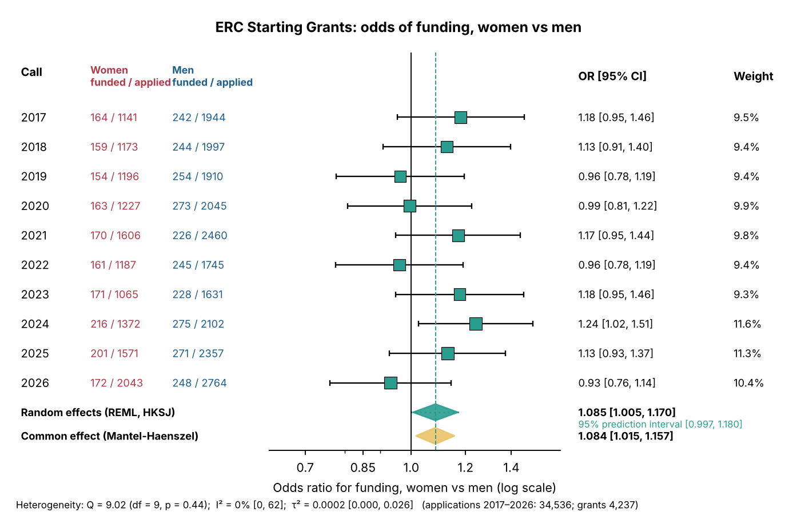

Six estimators agree to the third decimal: MH 1.084 (1.015–1.157, p = 0.016); inverse-variance 1.085 (1.016–1.158); DL/PM/REML 1.085; REML + HKSJ **1.085 (1.005–1.170, t₉ p = 0.038)**. On the other scales, RR = 1.074 (1.006–1.148) and RD = +0.81 pp (−0.04 to +1.66). Heterogeneity is absent: Q = 9.02 (p = 0.44), I² = 0 % (95 % CI 0–62 %), τ² = 0.0002 (Q-profile CI 0–0.026); the prediction interval 0.997–1.180 shows that a future call with OR < 1 is entirely plausible even though the average is above 1.

### 4.2 Time trend, influence and small-study diagnostics (Figures 2–5)

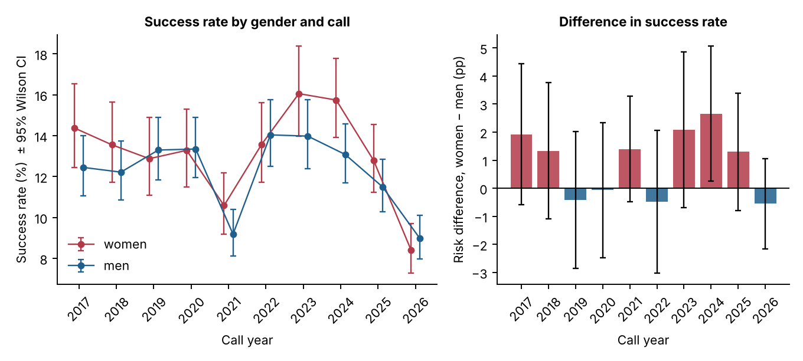

Meta-regression on year gives −0.0027 log-OR per year (95 % CI −0.031 to +0.026; Knapp–Hartung p = 0.83; permutation p = 0.84), i.e. an OR ratio of 0.97 per decade; the Horizon Europe era differs from Horizon 2020 by a factor 1.035 (0.876–1.222). The cumulative meta-analysis (Figure 3) is stable from 2020 onward (1.06–1.10); leaving out any single call moves the pooled OR only between 1.066 and 1.104 (max Cook's D 0.28 for 2024; max |studentised residual| 1.55). Egger's intercept is −6.99 (p = 0.41), Peters p = 0.70, Begg p = 0.86; trim-and-fill imputes one call on the right and gives 1.103 (1.021–1.192). Because all calls have near-identical precision, funnel-based methods have almost no leverage here—an intrinsic feature of a series of similarly-sized competitions, not a finding.

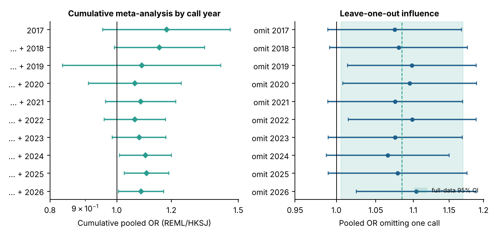

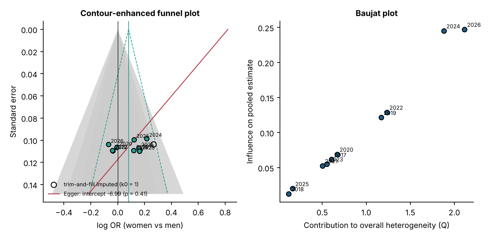

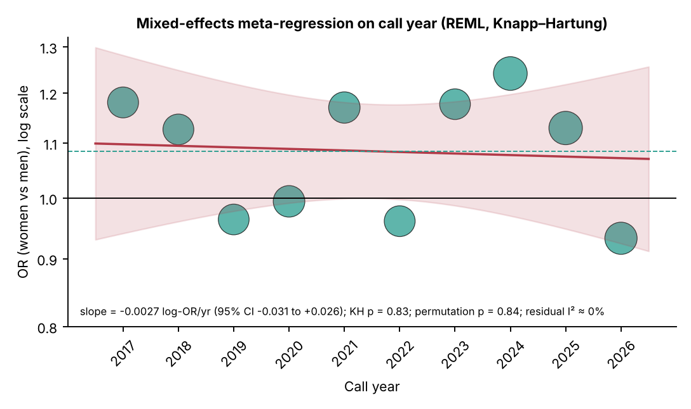

### 4.3 Bayesian analysis (Figure 6)

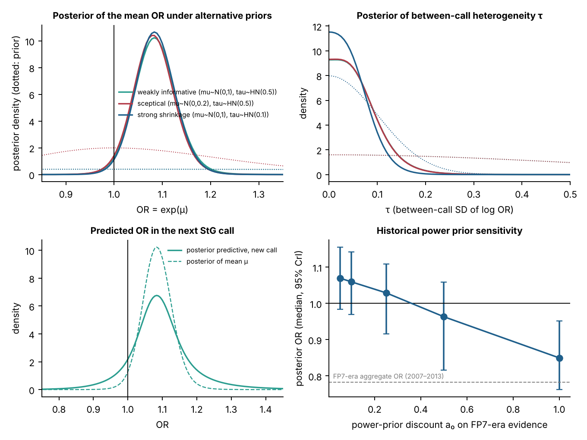

Under the exact-conditional model with weakly informative priors the posterior median OR is 1.081 (95 % CrI 0.996–1.172); P(OR < 1) = 0.024; P(0.91 < OR < 1.10) = 0.67; P(OR > 1.10) = 0.33; τ has posterior median 0.048 (97.5th percentile 0.17); the predictive interval for the next call is 0.90–1.29. The Savage–Dickey Bayes factor is 0.31 (evidence for no difference is "anecdotal") under the N(0, 1) prior and 1.40 under the sceptical N(0, 0.2) prior—the data do not discriminate strongly between "no difference" and "a small female advantage". The marginal MLE of the same model is 1.083 (profile CI 1.015–1.156). The normal-normal model gives identical results to two decimals, confirming that the normal approximation is harmless at these cell sizes.

Power priors: with the FP7-era aggregate discounted to a₀ = 0.1 the posterior is 1.059 (0.970–1.142); at a₀ = 0.25, 1.029 (0.916–1.109); only at a₀ ≥ 0.5 does the historical disadvantage pull the posterior below 1. Since the FP7 rates are rounded and pre-date the ERC's gender-equality plan and eligibility-window extensions, a₀ ≤ 0.1 is the defensible range.

### 4.4 Quantitative bias analysis (Figures 7–8)

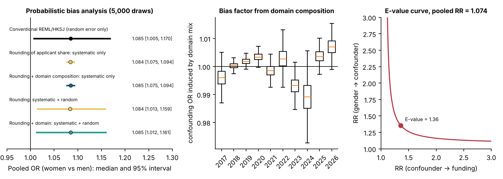

* **Rounding of the applicant share.** Systematic-error-only interval for the pooled OR: 1.084 (1.075–1.094); with random error 1.084 (1.013–1.159); P(OR < 1) = 0.9 %. The published rounding is therefore immaterial for the pooled estimate, although it can shift individual calls by ±4 % (e.g. 2026).
* **Domain composition.** Because the ERC allocates panel budgets in proportion to demand, success rates hardly differ across domains; the confounding OR induced by composition ranges from 0.989 (2024) to 1.007 (2026). Adding it to the rounding analysis leaves the pooled OR at 1.085 (1.012–1.161).
* **Unmeasured confounding.** E-value 1.36 for the point estimate and 1.08 for the confidence limit; to mask a true disadvantage of RR = 0.90 an unmeasured factor would need associations of 1.67 with both gender and funding (1.48 for the limit).
* **Self-selection (Figure 8).** With the observed pool (39.3 % women, 12.3 % success), a fair evaluation with perfect reliability would produce OR = 1.085 if the female applicant pool were shifted by δ = 0.043 SD (0.051 at ρ = 0.7; 0.061 at ρ = 0.5). If women self-select more stringently by δ = 0.2 SD—a magnitude within the range discussed in the "women apply only when highly qualified" literature—the observed OR implies an evaluation-stage OR of 0.75 (ρ = 1), 0.79 (ρ = 0.7) or 0.83 (ρ = 0.5). The success-rate contrast is thus consistent with neutrality, with a small female advantage, and with a moderate female disadvantage at the evaluation stage, depending on an unobserved quantity.

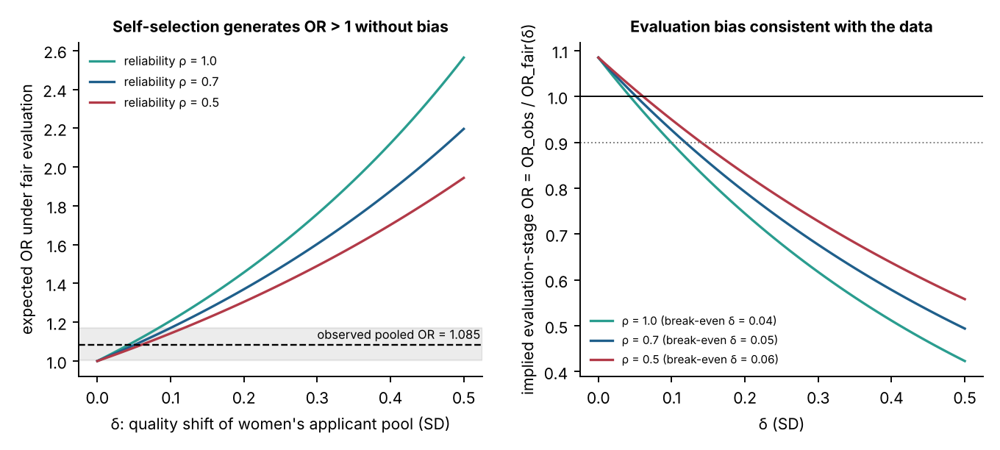

### 4.5 Sensitivity analyses (Figure 10)

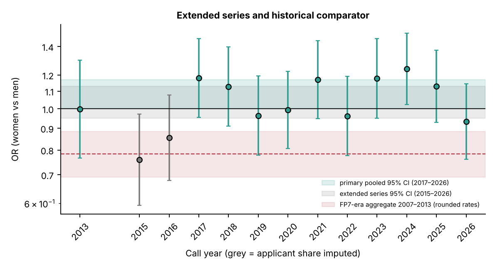

| Analysis | OR (95 % CI) | Note |
|---|---|---|
| Non-binary grantees removed from the denominator | 1.084 (1.005–1.170) | negligible |
| Updated 2023 counts (398 funded incl. reserve list) | 1.088 (1.006–1.176) | negligible |
| Extended 2013–2026 (2013, 2015, 2016 with imputed applicant share; Monte Carlo) | 1.036 (0.954–1.124) | I² ≈ 42 % (97.5 % 57 %) |
| Extended 2013–2026, point imputation | 1.036 (0.951–1.129) | trend +0.015/yr, perm. p = 0.16 |
| FP7-era comparator 2007–2013 (rounded rates) | 0.78 (range 0.69–0.89) | historical |
| StG 2007–2016 share-based (31 % of applications, 27 % of grants) | 0.82 | historical |

The extended series shows that the 2015–2016 calls sit at OR ≈ 0.8 (2013 close to 1 under its imputed share), that the shift to OR > 1 coincided with the 2017 call (record women's share of 37 %), and that once they are included a positive trend of about +16 % per decade emerges (not significant with k = 13).

### 4.6 Counterfactual grant gap

Had women been funded at men's rate in each call, 116 fewer grants (95 % CI 20–213) would have gone to women over 2017–2026 (from a total of 1,731), i.e. about 12 grants per call, with 2024 the only call in which the excess is individually distinguishable from zero (+36.5, CI 3.5–69.5).

### 4.7 Geography (Figure 9)

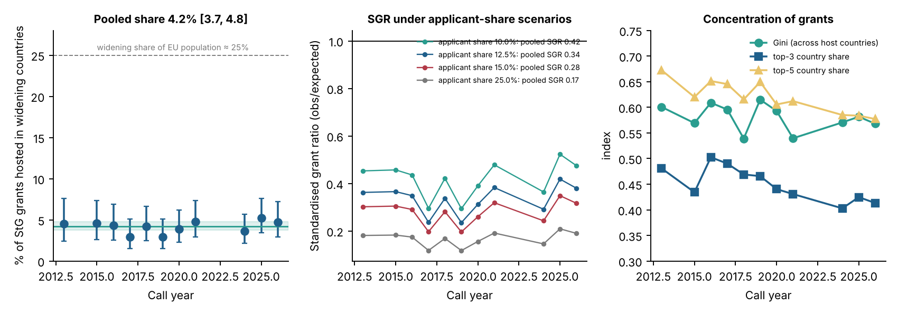

Widening Member States host 4.20 % of StG grants (95 % CI 3.67–4.80 %; Q p = 0.77; I² = 0 %; prediction interval 3.7–4.8 %), with a year slope of +0.018 on the logit scale (Knapp–Hartung p = 0.30; permutation p = 0.28). Including associated widening countries gives 4.60 % (4.06–5.22 %). Standardised grant ratios are 0.42, 0.34, 0.28 and 0.17 for assumed widening shares of applications of 10 %, 12.5 %, 15 % and 25 %, corresponding to success-rate ratios of 0.40, 0.31, 0.25 and 0.13 against the rest of Europe. The ERC's March-2026 white paper (success rates 1–7 % vs ~11 %) is consistent with an applicant share of roughly 10–15 %. Concentration is stable: mean Gini 0.58, Herfindahl 0.10, top-3 countries 45 % and top-5 61 % of grants.

### 4.8 Selection-mechanism simulation (Figure 11)

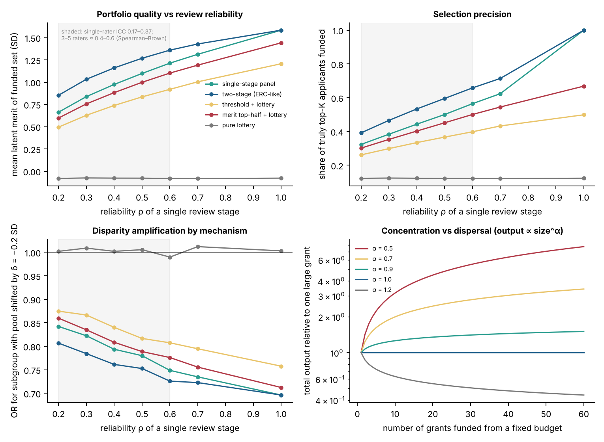

At panel-level reliability ρ = 0.5 the funded set's mean latent merit is 1.10 SD under a single-stage panel, 1.27 under the ERC-like two-stage design (+0.17 SD, precision from 50 % to 60 % of the true top-K funded, with 1,050 instead of 3,500 full reviews), 0.84 under threshold-plus-lottery (−0.26 SD; precision 37 %), 1.00 under merit-top-half-plus-lottery (−0.10 SD; precision 45 %) and −0.08 under a pure lottery. A subgroup whose applicant pool is shifted by −0.2 SD (a stylised widening-country pool) has an OR of 0.78 under the single-stage panel and 0.75 under two-stage, versus 0.82 with threshold-plus-lottery and 1.0 under pure lottery: merit ranking amplifies pool differences, and the amplification grows with reliability. At ρ = 0.3 the same qualitative pattern holds with smaller absolute merit levels (Table 11).

### 4.9 Competition dynamics (Figure 12)

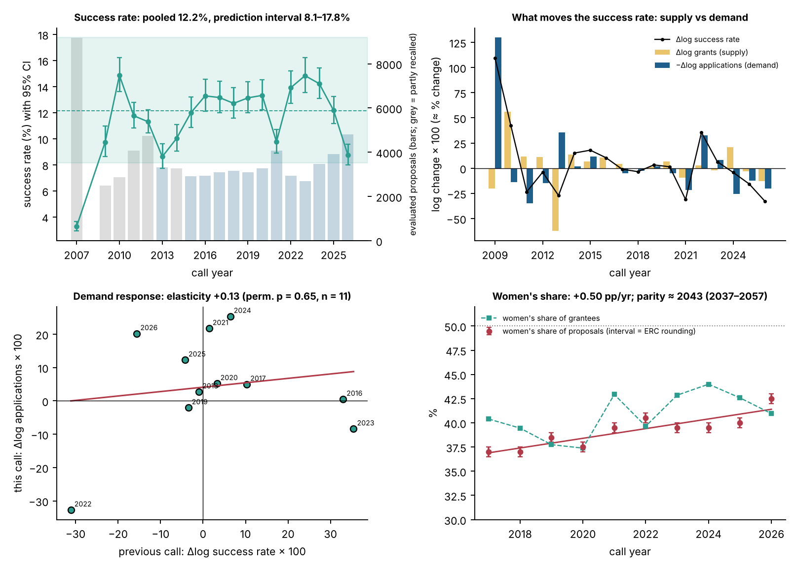

The success rate is anything but a constant of the scheme. Pooled over the thirteen verified calls it is 12.2 % (95 % CI 10.9–13.5 %), but the between-call SD on the logit scale is 0.19 (I² = 93 %) and the prediction interval is 8.1–17.8 %. Pairwise cohort odds ratios range from 0.54 to 1.85; the odds of funding for an applicant of given quality were 42 % lower in 2026 than in 2024 and 45 % lower than in 2023. The last change decomposes into +20.2 log-points of applications and −12.7 log-points of grants (−32.9 log-points of success rate, 61 % attributable to demand). Demand does not respond materially to the previous call's success rate: elasticity +0.13 (HC1 SE 0.40; permutation p = 0.65; n = 11) in the verified series and +0.16 (SE 0.12; p = 0.27; n = 17) in the extended series—the 2022 drop after the 2021 surge (a one-off widening of the eligibility window) is the only large negative response and it is a rule change, not a price response. Because applications do not fall when success rates fall, the scheme's "application tax" grows with demand: for the 2026 call 4,807 proposals represent 437, 743 or 1,093 person-years of preparation at 20, 34 or 50 working days per proposal, i.e. 1.0, 1.8 or 2.6 person-years per grant, equivalent to 21–52 % of the PI-years the call funds (421 grants × 5 years).

The women's share of proposals rises by 0.50 pp per year (SE 0.09; p < 0.001; 37 % → 42.5 %) and the grantee share by 0.43 pp per year; the representation gap (grantee minus applicant share) is positive in seven of ten calls (+3.4, +2.5, −0.8, −0.1, +3.4, −0.8, +3.4, +4.5, +2.6, −1.5 pp) but individually significant only in 2024. A linear extrapolation reaches a 50 % applicant share around 2043 (bootstrap interval 2037–2057; probability of parity before 2035 ≈ 0).

### 4.10 Domain neutrality and the shift of demand (Figure 13)

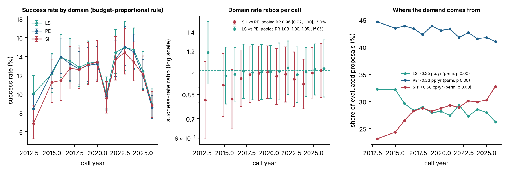

The rule that panel budgets follow requested budgets makes the three domains' success rates nearly identical: the largest within-call max/min ratio is 1.46 (2013) and the median 1.05; no call rejects equality (all chi-square p > 0.05). Pooled over thirteen calls the SH:PE rate ratio is 0.96 (0.92–1.00; p = 0.07) and LS:PE 1.03 (1.00–1.05; p = 0.04), both with I² = 0 %; the SH:PE ratio has been rising by +1.1 % per year (permutation p = 0.02), i.e. an early SH disadvantage has closed. Demand, meanwhile, has migrated: SH proposals grew from 23.1 % to 32.8 % of the total (+0.58 pp/yr), while LS fell from 32.2 % to 26.2 % and PE from 44.6 % to 41.0 % (all permutation p ≤ 0.002). Because budgets follow demand, this shift has moved money towards the social sciences and humanities without any explicit policy decision.

For 2025, the only call with a gender × domain split of grantees (F 55/64/82, M 79/133/59 in LS/PE/SH), the domain-specific ORs depend entirely on the unpublished within-domain applicant shares: under a uniform 40 % share they would be 1.05 (LS), 0.69 (PE) and 2.31 (SH); under the central scenario (LS 45 %, PE 29 %, SH 51 %) 0.84, 1.19 and 1.42; under a steep scenario 0.75, 1.57 and 1.17. The applicant shares that would make every domain exactly neutral are LS 41 %, PE 32 %, SH 58 %, averaging 42.7 % against the published 40 %. The sign of any domain-specific gender effect is therefore unidentified from public data—an argument for the ERC to publish applicants by domain × gender.

### 4.11 Host-country shares and association status (Figure 14)

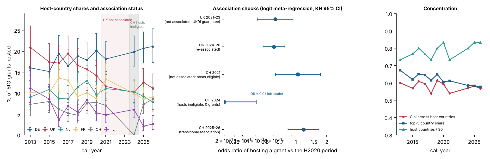

The host-country ranking is remarkably stable (Spearman ρ between consecutive calls 0.81–0.96; 0.78 between 2013 and 2026), and concentration is flat to slightly declining (Gini −0.002 per year; top-5 share 67 % in 2013, 58 % in 2026; 22–25 countries host at least one grant). Against this stability, the framework-association shocks stand out. The UK hosted 17.3 % of StGs under Horizon 2020; during its non-association (2021–23, proposals funded through the UKRI guarantee) the share was 11.6 % (OR 0.63, 0.42–0.94), and after re-association (2024–26) 11.3 % (OR 0.61, 0.48–0.78; permutation p = 0.007)—the loss has so far been permanent. Germany's share rose from 16 % to 21 % over the same period. Switzerland's share was unaffected in 2021 (7.1 %; OR 1.05), was mechanically zero in 2024 when Swiss institutions were ineligible to host, and returned to 7–9 % from 2025 (OR 1.19, 0.84–1.68). Israel's share has fallen from 11 % (2013) to 2–3 % in 2025–26, a change not linked to association status and left as an observation. Reallocation arithmetic for the widening gap: bringing widening hosts to parity with an applicant share of 10 %, 12.5 % or 15 % would have required 24, 34 or 44 additional grants per call (6 %, 8 % or 11 % of all grants).

### 4.12 Evidence-to-decision: what the reliability literature implies for ERC selection (Figure 15)

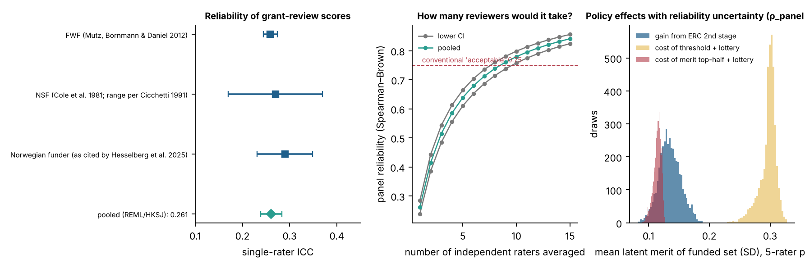

Pooling the three documented single-rater intraclass correlations gives 0.26 (0.24–0.28; τ² = 0 with k = 3). By Spearman–Brown, a three-rater panel reaches 0.51 and a five-rater panel 0.64; averaging two independent five-rater stages gives 0.78, which is the mechanism by which the ERC's two-step design approaches conventionally "acceptable" reliability. Propagating a five-rater reliability of 0.64 (0.49–0.74, allowing an assumed between-funder SD of 0.05) through the simulator: the two-stage design adds 0.13 SD (0.10–0.17) of mean funded merit and 9 points of true-top-K precision; a threshold-plus-lottery costs 0.30 SD (0.26–0.32) and 18 points (13–23) of precision while raising a disadvantaged subgroup's OR by 0.06 (from 0.74 to 0.80); a merit-top-half-plus-lottery costs 0.12 SD (0.10–0.12) and 7 points. The reliability uncertainty changes the size of these effects, not their ordering.

## 5. Interpretation

1. **On the gender question the ERC StG record since 2017 shows no disadvantage for women at the level of success rates**; the best estimate is a small advantage (OR 1.08) that is robust to every model, estimator, influence and bias check applied, but whose evidential weight against exact parity is modest (BF₁₀ 0.3–1.4; prediction interval spanning 1).
2. **Parity of success rates is not evidence of neutral evaluation.** The self-selection sensitivity analysis is the central methodological message: the quantity that separates "fair" from "biased" evaluation—the quality differential of the applicant pools—is unobserved in call-level data and needs applicant-level pre-application productivity, which only the ERC holds. The break-even differential is small (≈ 0.05 SD).
3. **The historical reversal is real.** From OR ≈ 0.78 (2007–2013) and ≈ 0.8 (2015–2016) to ≈ 1.08 (2017–2026) is a change of roughly 0.3 on the log-odds scale, coinciding with the rising share of women among applicants (30 % → 43 %) and the ERC's gender-equality measures; whether it reflects changed evaluation or changed self-selection is, again, not identifiable here.
4. **Geography is the larger disparity.** A widening-country share of 4 % against a population share of 25 % and (under any plausible applicant share) success-rate ratios of 0.25–0.40 dwarf the gender contrast. The ERC's own white paper attributes this to structural conditions in host institutions; testing that claim requires the unpublished applicant denominators by country.
5. **Cohort luck and the application tax are first-order problems.** The same proposal has odds of success that differ by up to 1.85-fold between calls, purely because demand and budgets move; demand does not self-correct when success rates fall, so the deadweight cost of unfunded proposals grows mechanically (1–2.6 person-years per grant in 2026). Stabilising the success rate (multi-year budget smoothing or capping resubmissions) is a cheaper intervention than most reforms of the evaluation itself.
6. **Domain neutrality is achieved by design, and demand is shifting towards SH.** The budget-follows-demand rule delivers near-identical success rates, but it also lets the disciplinary composition of the portfolio drift with application behaviour (SH +10 pp since 2013) without an explicit decision.
7. **Association status has durable consequences.** The UK's one-third loss of hosted StGs persisted three calls after re-association; the ERC portfolio re-concentrated in Germany. This is the cleanest natural experiment in the data and deserves applicant-level follow-up (did UK-based applicants stop applying, move, or lose at evaluation?).
8. **Reliability is the policy lever.** The simulation reproduces three known results with ERC-specific numbers: two-stage evaluation is efficient; lotteries cost merit precisely in proportion to reliability; and any ranking mechanism amplifies differences between applicant pools. The public/private funding debate (HHMI vs NIH) is, in these terms, a debate about horizon, tolerance of failure and people-vs-project focus—features the ERC already embodies—rather than about the source of the money.

## 6. Limitations

* Applicant gender is taken from rounded shares; propagated, but the 2026 share is from secondary reporting.
* Non-binary applicants are assumed negligible in the applicant pool (they are 0–6 among grantees).
* Grant counts differ between initial and reserve-list releases (2021: 397 vs 471; 2023: 400 vs 398); the version with the gender split is used, with a sensitivity check.
* The historical comparator is an aggregate of rounded rates; the 2015–2016 shares are imputed.
* Domain-composition adjustment relies on assumed within-domain shares (calibrated, ±0.15).
* No applicant counts by country are published; the geographic success-rate ratio is scenario-based.
* Grant counts for 2007–2012 and 2014 in the competition series are as recalled from ERC releases (applications verified); the verified-only series (k = 13) is used for the success-rate meta-analysis and the primary elasticity estimate.
* The application-cost figures rest on an external per-proposal time estimate (20–50 working days); they are order-of-magnitude, not accounting, numbers.
* The parity projection is a linear extrapolation over a 10-call window and should be read as a scenario.
* Association-status contrasts are descriptive: no applicant denominators by country exist, so they cannot separate reduced applications from reduced success.
* The reliability meta-analysis has k = 3 with one dominant study; the between-funder SD used in propagation (0.05) is an assumption.
* The policy simulator is a stylised model (normal merit, independent stage errors, fixed pool multiplier); its value is in the ordering and the sensitivity to ρ, not in the absolute numbers.
* The literature entries in `data/evidence_map.csv` are as reported by their authors; two are marked as not re-verified.

## 7. Reproducibility

`python run_all.py` (≈ 2 min, numpy/scipy/pandas/matplotlib only) regenerates all 26 tables (`outputs/tables/`), 15 figures (`outputs/figures/`), `outputs/results.json` and `outputs/key_results.md`. The package layout is described in `README.md`. Random seeds are fixed; the Bayesian analysis is deterministic.

## 8. Principal sources

ERC per-call statistics PDFs (2015–2026) and "facts and figures" releases (URLs in `outputs/tables/table0_provenance.csv`); ERC Gender Statistics (Dec 2016, June 2022); EURAXESS summary of ERC gender statistics (FP7 StG success rates); ERC Scientific Council white paper (March 2026); Ghirelli et al. (2023) IZA DP 16108; Wang, Jones & Wang (2019) Nature Communications; Azoulay, Graff Zivin & Manso (2011) RAND J Econ; Schmaling & Gallo (2023) Res Integr Peer Rev; Bornmann, Mutz & Daniel (2007) J Informetrics; Mutz, Bornmann & Daniel (2012) PLoS ONE; Bornmann, Mutz & Daniel (2010) PLoS ONE; ERC *funding activities 2007–2013*; Herbert, Barnett, Clarke & Graves (2013) BMJ Open (time spent preparing proposals). Methods: DerSimonian & Laird (1986); Paule & Mandel (1982); Viechtbauer (2007, Q-profile); Higgins & Thompson (2002); IntHout, Ioannidis & Borm (2014, HKSJ); Stijnen, Hamza & Özdemir (2010, exact conditional models); Duval & Tweedie (2000); Peters et al. (2006); Lash, Fox & Fink (2009, probabilistic bias analysis); VanderWeele & Ding (2017, E-values); Ibrahim & Chen (2000, power priors).
